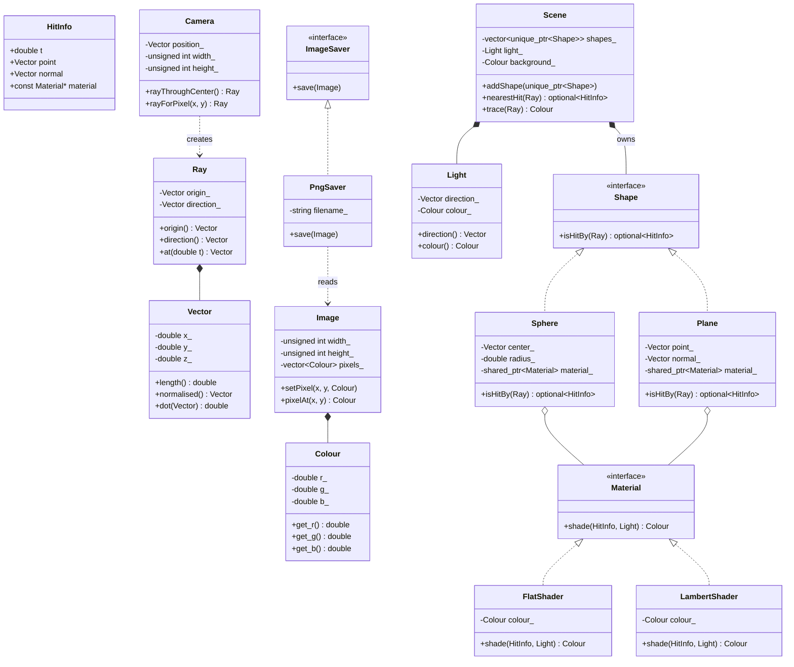

# Domain Model — Raytracer (`m1`)

This diagram maps the core domain concepts of the raytracer and their relationships, reflecting the `m1` architecture (a ball lit by the sun on a floor).

## Key Design Decisions

- **Composition over inheritance:** `Sphere` and `Plane` each hold a `Material` rather than creating shape × material inheritance hierarchies.
- **Open/Closed & Dependency Inversion:** `Scene` depends only on the `Shape` and `Material` interfaces; `main.cpp` acts as the single Composition Root wiring concrete classes (`Sphere`, `Plane`, `LambertShader`, `PngSaver`).
- **Adapter & Strategy patterns:** `PngSaver` isolates LodePNG behind `ImageSaver`, and `Material` allows swapping shading strategies (`FlatShader`, `LambertShader`) without modifying `Scene`.
